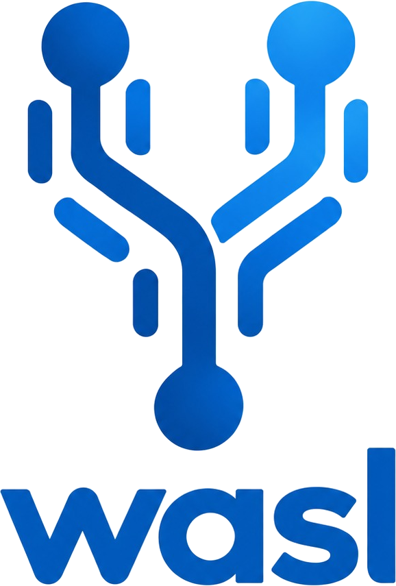

<p align="center"></p>

<h1 align="center">Wasl — وصل</h1>
<p align="center"><b>Document an achievement once. Use it everywhere.</b><br>
AI career platform that turns real achievements into LinkedIn posts, Master-CV updates (Accept / Edit / Reject),
honest tailored CVs and a skill-gap roadmap — with a live Monitoring & Evaluation system.</p>

---

## Why

Professionals describe the same achievement again and again: on LinkedIn, in the CV, in each job application.
Generic AI writers make this faster but **invent** metrics, skills and titles. Wasl keeps one verified source of
truth (confirmed achievements + an approved Master CV) and makes every AI output traceable to it.

## What it does

| Feature | Highlights |
|---|---|
| **Achievement Discovery** | Free text, uploaded PDF/DOCX certificates, or GitHub repositories → structured achievements. Evidence quotes are verified against the source, unsupported terms are dropped, repositories always ask *what you personally did*. Duplicate detection. |
| **LinkedIn Post Studio** | 6 tones, English & Arabic, claim-checked (auto-revised once), editable preview, drafts. Publishing via LinkedIn OAuth only after an explicit confirmation dialog; atomic lock prevents duplicate posts; ambiguous results are never reported as success. |
| **CV Manager** | Upload & parse CV → review → Master CV. Confirmed achievements automatically produce a **separate draft** with Accept / Edit / Reject; Master CV is versioned (history + restore) and never silently modified. PDF & DOCX export (Arabic supported). |
| **CV Tailoring** | Extracts requirements, deterministic evidence matching, explainable match score, side-by-side original vs tailored. An *honesty guard* rejects rewritten bullets that add claims not in your CV. |
| **Career Gap Analyzer** | Verified vs **unverified** (claimed but unproven) vs missing skills, prioritised week-by-week roadmap. |
| **Monitoring & Evaluation** | Real events → metrics → dashboard + threshold alerts: failure rate, p50/p95/p99 latency, tokens by provider & task, fallback rate, unsupported-claim rate, CV acceptance rate, extraction precision, task success, API health, error log. Reproducible evaluation dataset. |
| **Settings / BYOK** | Profile, LinkedIn & GitHub connections, AI mode (platform / my keys first / my keys only), fallback & cross-provider privacy switches, encrypted personal API keys validated with the provider. |

UI: hand-drawn "workflow machine" design system (paper ✏️ / blueprint 🌙 themes), English + Arabic with full RTL, responsive.

## Architecture (short)

```
frontend/  Next.js 16 · TypeScript · Tailwind 4 · shadcn-style Radix components · Recharts
backend/   FastAPI · SQLAlchemy 2 · Pydantic 2 · LangGraph · httpx provider adapters
supabase/  Postgres schema + Row Level Security + private Storage bucket
```

* **3 LangGraph agents**: Content Generation · Achievement Discovery & Verification · CV Optimization & Career Analysis
* **AI Model Router**: Groq / Gemini / OpenRouter adapters, task-tier model selection, timeouts, retries with backoff, Retry-After, JSON-schema validation + one repair round, compatible fallback, BYOK & privacy preferences, per-attempt telemetry.
* **Never-invent guarantees** are enforced in code (deterministic claim checker + evidence verification), not only in prompts.

Details: [docs/ARCHITECTURE.md](docs/ARCHITECTURE.md) · Monitoring: [docs/MONITORING.md](docs/MONITORING.md) · Evaluation: [docs/EVALUATION.md](docs/EVALUATION.md)

## Quick start (local, ~5 minutes)

Requirements: Python 3.11+ (tested 3.14), Node 20+ (tested 24).

```bash
# backend
cd backend
python -m venv .venv && .venv/Scripts/activate      # macOS/Linux: source .venv/bin/activate
pip install -r requirements-dev.txt
cp .env.example .env        # add GROQ_API_KEY and/or GEMINI_API_KEY (free) — see docs/SETUP.md
uvicorn app.main:app --reload --port 8000

# frontend (new terminal)
cd frontend
npm install
cp .env.example .env.local
npm run dev                 # http://localhost:3000
```

Optional demo account with a clearly-labelled **sample** CV: `python -m scripts.seed_demo` (backend/).

Without any AI key the app runs and every AI feature shows a clear *"AI is not available"* state — nothing is simulated.

## Integration status

| Integration | Code | Verified in this repo | Needs from you |
|---|---|---|---|
| SQLite (local) | ✅ | ✅ tests + browser | — |
| Supabase Postgres / Auth / Storage / RLS | ✅ | ⚠️ not yet run against a live project | Supabase project + keys |
| Groq / Gemini | ✅ | ✅ live calls, fallback verified, 17/17 evaluation cases | — |
| LinkedIn OAuth + publishing | ✅ | ⚠️ app configured; redirect URL must be registered | redirect URL in LinkedIn app |
| GitHub OAuth + repo scan | ✅ | ⚠️ credentials valid; callback URL must be updated | callback URL in GitHub app |

Full, honest status: [docs/PROGRESS.md](docs/PROGRESS.md).

## Quality checks

```bash
cd backend && pytest -q && ruff check app tests        # 23 tests: units + end-to-end API journeys
cd frontend && npx tsc --noEmit && npm run lint && npm run build
cd backend && python -m app.evaluation                 # real-model evaluation (needs a provider key)
```

## Project deliverables

| Deliverable | Where |
|---|---|
| Report (problem, solution, data, metrics, evaluation, tools, decisions) | [docs/REPORT.md](docs/REPORT.md) |
| Development Flow + Monitoring Flow diagrams | [docs/ARCHITECTURE.md](docs/ARCHITECTURE.md#development-flow), [docs/MONITORING.md](docs/MONITORING.md#monitoring-flow) |
| Pitch outline (3 min) + Q&A prep (10 min) | [docs/PITCH.md](docs/PITCH.md) |
| Setup & configuration guide | [docs/SETUP.md](docs/SETUP.md) |
| Progress / acceptance criteria / test results | [docs/PROGRESS.md](docs/PROGRESS.md) |

Built for the Tuwaiq Academy × Meta × Startupbootcamp *AI Product Development and Monitoring* project (Oct 2026).
