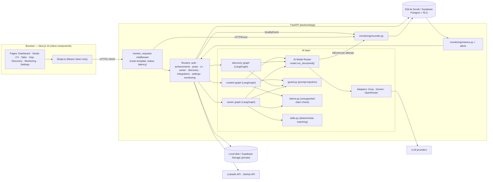
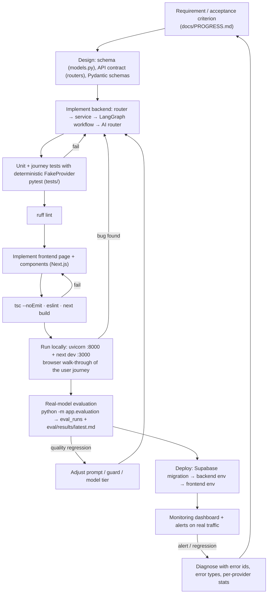

# Wasl — Technical Architecture

## 1. System overview



## 2. Folder structure

```
wasl/
├─ backend/
│  ├─ app/
│  │  ├─ main.py                 FastAPI app, middleware, error handlers
│  │  ├─ config.py               all settings from env (.env.example lists every variable)
│  │  ├─ db.py · models.py       SQLAlchemy engine + 17 tables (user data + monitoring)
│  │  ├─ deps.py                 auth dependency, ownership checks, task tracking
│  │  ├─ security/               auth.py (local JWT / Supabase JWT), crypto.py (Fernet), guard.py (injection)
│  │  ├─ ai/
│  │  │  ├─ providers/           base.py contract · openai_compat.py (Groq, OpenRouter) · gemini.py · fake.py (tests only) · registry.py
│  │  │  ├─ router.py            AI Model Router
│  │  │  ├─ schemas.py           Pydantic CV format + every structured output
│  │  │  ├─ claims.py · skills.py deterministic verification
│  │  │  └─ workflows/           content.py · discovery.py · career.py  (LangGraph)
│  │  ├─ routers/                one file per product area
│  │  ├─ services/               documents (validation/extraction/storage), export (PDF/DOCX), linkedin, github, cv_updates
│  │  ├─ monitoring/             recorder.py (writes), metrics.py (aggregation + alerts)
│  │  └─ evaluation.py           offline evaluation runner
│  ├─ eval/dataset.json          reproducible evaluation dataset
│  ├─ scripts/seed_demo.py       local demo account (sample data, labelled)
│  └─ tests/                     pytest: units + end-to-end API journeys
├─ frontend/src/
│  ├─ app/                       routes (landing, auth, (app)/* pages)
│  ├─ components/                ui/ (shadcn-style), sketch/ (illustrations), domain components
│  └─ lib/                       api client, auth/theme/toast providers, i18n (en/ar), types
├─ supabase/migrations/0001_init.sql   schema + RLS + storage bucket/policies
└─ docs/
```

## 3. AI architecture

Three logical agents (LangGraph state machines). They share the router and tools; no agent exists only for show.

| Agent | Graph | LLM calls | Deterministic safeguards |
|---|---|---|---|
| **Professional Content** (`workflows/content.py`) | `generate → claim_check → (revise → claim_check)? → END` | post_generation, post_improve | claim checker; revise node removes only flagged claims; final unsupported claims are shown before publishing |
| **Achievement Discovery & Verification** (`workflows/discovery.py`) | `sanitize → extract → verify_evidence → dedupe → END` | achievement_extraction / repo_analysis | injection redaction; quotes must literally appear in source; skills not in source are dropped; confidence down-weighted; repos always require contribution confirmation; fingerprint + Jaccard duplicate detection |
| **CV Optimization & Career Analysis** (`workflows/career.py`) | `requirements → match → {tailor → enforce} | {roadmap}` + `parse_cv`, `propose_cv_update` | job_requirements, cv_tailor, gap_roadmap, cv_parse, cv_update | evidence matching & explainable score are pure Python; `enforce` rejects bullets with unsupported claims and unknown item ids; CV updates are applied to a *copy* by code, never by the model |

### AI Model Router (`ai/router.py`)

1. **Task profile** → tier (`fast`/`quality`), token budget, temperature (e.g. `job_requirements` uses the fast tier).
2. **Candidates** from user preferences:
   `platform` → platform keys in `AI_PROVIDER_PRIORITY` order · `personal_first` → user keys then platform (if allowed) ·
   `personal` → user keys only unless fallback allowed · `allow_cross_provider=false` → only the first provider company ever receives the data.
3. **Per attempt**: timeout (`AI_TIMEOUT_SECONDS`), classify errors (`timeout · rate_limit · auth · bad_request · server · network · empty`).
   Retryable errors → exponential backoff (honours `Retry-After`, capped 8 s) up to `AI_MAX_RETRIES`; `auth/bad_request` → next provider.
4. **Structured output**: JSON mode + schema in the system prompt → parse → Pydantic validation → one repair round-trip → else fallback.
5. **Telemetry**: one `ai_events` row per attempt (provider, model, tokens, latency, status, error class, fallback flag, key source). No prompt/completion text.
6. **All failed** → `AIUnavailableError` with a user-safe explanation → HTTP 503 `{"code":"ai_unavailable"}` → UI shows an actionable state.

Model choice (verified 2026-10-20 against the providers' live model lists): Groq `openai/gpt-oss-120b` (quality) / `openai/gpt-oss-20b` (fast) with `reasoning_effort=low` — primary, < 1 s; Gemini `gemini-3.5-flash` with `thinkingLevel=low` — fallback, ~8–17 s. The originally planned Llama 3.x (Groq) and Gemini 2.5 models had been retired for new keys; the router reported them as `model_not_found`, which is how the problem was diagnosed. All configurable in `.env`.

## 4. Data model (main tables)

`users` (incl. AI prefs) · `achievements` (status pending/confirmed/rejected, evidence, fingerprint) · `posts` (draft/publishing/published/failed/uncertain) ·
`cvs` (one `master` per user + `tailored`) · `cv_versions` · `cv_suggestions` (separate draft, pending/accepted/edited/rejected/stale) ·
`job_analyses` · `integrations` (encrypted tokens) · `oauth_states` · `user_api_keys` (encrypted) · `uploads` · `repo_snapshots` ·
monitoring: `ai_events` · `http_events` · `quality_events` · `error_logs` · `eval_runs`.

**Master-CV invariant:** the Master CV changes only through (a) explicit save in the editor, (b) Accept / Edit of a suggestion,
(c) version restore. Every change increments `version` and snapshots `cv_versions`. Pending suggestions built on an older
version become `stale` and cannot be accepted.

## 5. Security

| Concern | Implementation |
|---|---|
| Authentication | Local scrypt + HS256 JWT, or Supabase Auth tokens verified via JWKS / JWT secret |
| Data isolation | every query filtered by `user_id` (`deps.owned` returns 404 for foreign ids) + Postgres RLS `user_id = auth.uid()` |
| Secrets | provider keys only in backend env; BYOK keys & OAuth tokens Fernet-encrypted; never returned (only `…last4`) |
| OAuth | server-side code exchange, one-time random `state` (10 min), tokens never reach the browser |
| Uploads | extension allow-list, magic-byte check, 5 MB limit, page limit, encrypted PDFs rejected, private storage paths |
| Prompt injection | instruction-like sentences redacted, zero-width/bidi chars stripped, `<untrusted_data>` delimiters, outputs validated + claim-checked |
| External actions | LinkedIn publish requires `confirm: true` + UI dialog; atomic `draft→publishing` lock; timeouts mark `uncertain` (no auto-retry) |
| Logging | metadata only; `scrub()` redacts keys, bearer tokens and emails from error messages |
| Errors | unhandled exceptions return a reference id; details only in `error_logs` |

## Development Flow

How a change moves from idea to a verified, monitored release (this is the workflow used to build Wasl):



Environments: **local** (SQLite, local JWT, `.env`), **production** (Supabase Postgres/Auth/Storage, `APP_ENV=production` which
refuses to start without `JWT_SECRET`/`ENCRYPTION_KEY`). Tests never call real providers or external APIs.
