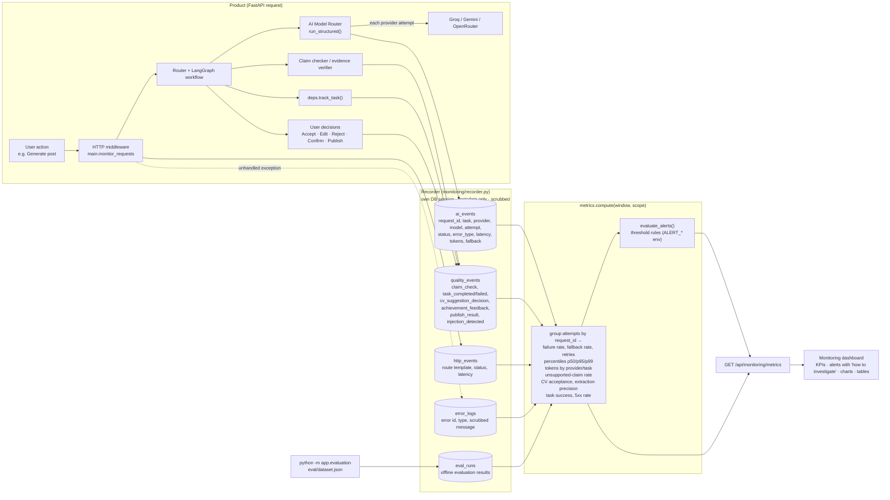

# Monitoring & Evaluation

Every number on the Monitoring page is computed by `backend/app/monitoring/metrics.py` from rows written by the running
product. Nothing is sampled, mocked or pre-filled; an empty database shows an empty state.

## Monitoring Flow

## Metric catalog — what, why, how it helps

| Metric | Source | Why it matters | How it helps investigate |
|---|---|---|---|
| **AI requests / attempts / retried** | `ai_events` grouped by `request_id` | load and retry pressure | many attempts per request ⇒ unstable provider |
| **AI failure rate** | requests with no successful attempt | what users actually feel | alert > `ALERT_FAILURE_RATE` (20%); check *Error types* |
| **Error types** | `ai_events.error_type` | root cause class | `rate_limit` = free-tier quota · `auth` = bad/expired key · `validation` = model broke the schema · `timeout` = slow provider · `no_provider` = no key configured |
| **p50 / p95 / p99 latency** (+ end-to-end p95 over time) | successful attempts; sum of attempts per request | tail latency drives UX; averages hide it | rising p95 with flat volume ⇒ provider slowdown; compare per-provider p95 |
| **Fallback rate** | successful requests served by a non-primary candidate | early warning before failures show | alert > 30%; look at primary provider's recent failures |
| **Tokens by provider & task** | `prompt_tokens`, `completion_tokens` | cost / free-tier budget | find the task that burns quota (e.g. CV parsing) |
| **Unsupported-claim rate** | `quality_events(kind=claim_check)` | hallucination proxy — core product promise | alert > 10%; which task? tighten prompt, force revise |
| **CV update acceptance rate** | Accept/Edit vs Reject decisions | usefulness of AI-drafted CV changes | many rejects ⇒ proposals irrelevant or badly phrased |
| **Extraction precision (proxy)** | confirmed vs rejected AI-discovered achievements | quality of discovery agent | low ⇒ extraction too eager; review prompt/confidence |
| **Task success rate** | `task_completed` vs `task_failed` per task | end-to-end health incl. DB + validation | isolates which user journey is broken |
| **Prompt-injection flags** | `injection_detected` events | security signal | spikes ⇒ someone probing uploads/READMEs |
| **API 5xx rate, 4xx, per-route p95** | `http_events` (route templates, no ids) | application health | 5xx ⇒ bug; each user error message carries an id found in *Recent server errors* |
| **Evaluation results** | `eval_runs` | quality before release | compare runs when changing prompts or models |

## Example investigation

1. Alert: *AI request failure rate is high — 42% (threshold 20%)*.
2. *Error types*: `rate_limit` dominates; *Providers* table: `groq` success 55%, `gemini` 0 attempts.
3. Diagnosis: Groq free-tier quota exhausted and no second provider configured → fallback impossible.
4. Fix: add `GEMINI_API_KEY` (router falls back automatically) or lower token budgets; fallback rate rises, failure rate drops.

## Privacy

`ai_events` store sizes and counts (input characters, token counts), never prompt or completion text. CV contents, API keys and OAuth
tokens are never logged. Error messages pass through `recorder.scrub()` (API-key patterns, bearer tokens, emails redacted).
Scope **Whole platform** shows aggregates only; **My requests** filters to the current user.

## Alerts

Defined in `metrics.evaluate_alerts()`; thresholds come from env (`ALERT_FAILURE_RATE`, `ALERT_P95_LATENCY_MS`,
`ALERT_UNSUPPORTED_CLAIM_RATE`, `ALERT_FALLBACK_RATE`). Minimum sample sizes prevent alerts on tiny data. Alerts are shown on the
dashboard with an *investigate* hint; wiring them to email/Slack is a documented next step.
